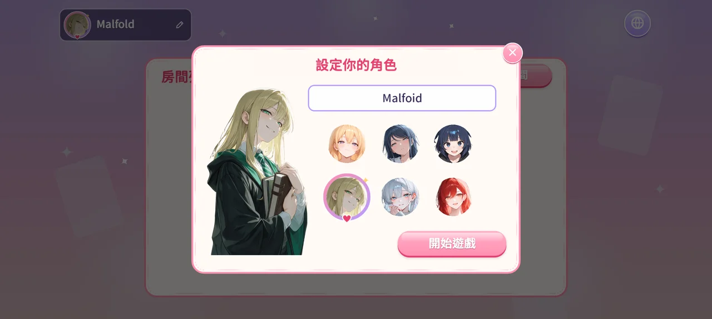
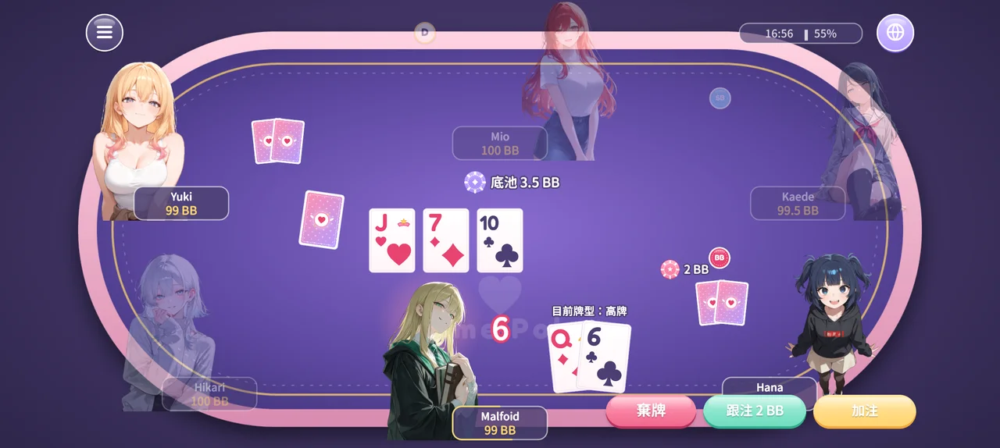
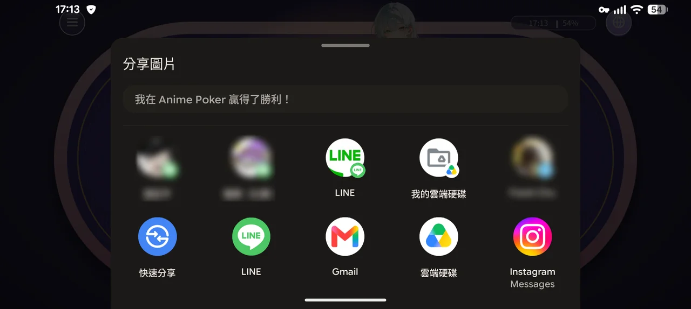
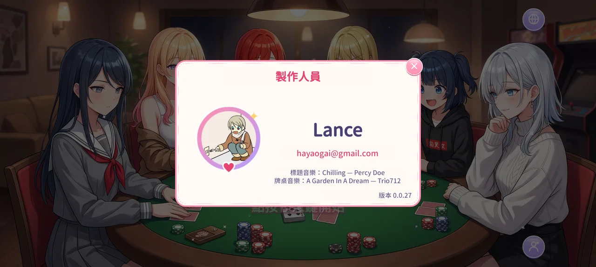

# Anime Poker


動漫美少女風格的多人德州撲克（No-Limit Texas Hold'em），支援 **Web（桌機／手機瀏覽器）** 與 **Android**。

- 用戶端：Cocos Creator 3.8.8 + TypeScript，MVVM 架構，以實際的 Scene 與 Prefab 製作。
- 伺服器：Node.js + TypeScript + Colyseus，由伺服器決定一切結果（server-authoritative）。
- Android 原生層：Java + Kotlin，透過 Cocos 的 JSB 橋接與遊戲互通。

## 遊戲畫面

一場完整的對局流程（Android 實機截圖）：

| ① 設定角色 | ② 房間大廳 |
|---|---|
|  |  |
| 第一次進入時設定暱稱與頭像，存在 localStorage，不需要登入。 | 房主可加入電腦玩家（以蒙地卡羅模擬估算勝率的 BotAI），最少 2 人即可開局。 |
| **③ 牌局進行** | **④ 比賽結束** |
|  |  |
| 沿名牌外框的倒數計時、目前牌型提示、依情境切換的行動按鈕；其他玩家的底牌在攤牌前不會送到用戶端。 | 畫面停在最後一手，勝利橫幅（AnimationClip）搭配彩帶與愛心粒子，可分享戰績或返回大廳。 |
| **⑤ 分享戰績** | **製作人員** |
|  |  |
| 截圖後經 Kotlin `ShareBridge`（FileProvider）呼叫系統分享面板；Web 版改用 Web Share API。 | 標題畫面的製作人員彈窗，版本號由 commit subject 自動帶入。 |

## 功能

**遊戲流程**
- **Title**：點按任意處開始、製作人員彈窗、語系切換（繁中／简中／English）、返回鍵退出確認。Web 版可切換全螢幕，Android 版固定為沉浸式全螢幕。
- **Lobby**：
  - 第一次進入時設定暱稱與頭像，存在 localStorage，不需要登入。
  - 房間列表即時更新，可建立、加入或觀戰。
  - 房主可以加入電腦玩家，電腦會優先使用牌桌上還沒有人用的頭像。
  - **離線對戰**：不需要連線，在本機和 3 位電腦對打，使用和伺服器相同的牌局邏輯。
- **Table**：
  - 最多 6 人，盲注從 1/2 起跳，每輪完一圈（手數等於當下參賽人數）升一級，依序為起始的 1、2、3、5、8、12、20、30、50、80 倍，每位玩家以 100 BB 開始，畫面上的籌碼以當下的大盲換算成 BB 顯示。
  - 每回合 10 秒，逾時自動過牌或棄牌。加注介面提供滑桿與 Min／½ Pot／Pot／All-in 快捷鍵。
  - 自己的底牌上方會提示目前牌型。
  - 左上角的選單（或返回鍵、Esc）開啟暫停選單：音樂、音效、人聲開關，以及改為觀戰、退出牌桌。離線對戰時開啟選單會暫停牌局。
  - 籌碼輸光就轉為觀戰。比賽結束後畫面停在最後一手並顯示結算橫幅，贏家可以分享戰績截圖，所有人自行按「返回大廳」離開。
  - 斷線後有 20 秒可重新連線。

**動畫與特效**
- 發牌、翻牌、籌碼下注與收池（貝茲曲線飛行）。
- 沿名牌外框的倒數計時（綠→黃→紅）、攤牌時只標亮構成牌型的牌、贏家光暈。
- 勝利橫幅（AnimationClip），以及金幣、彩帶、愛心粒子。
- 標題與牌桌各有背景音樂，切換場景時不中斷；啟動時由黑畫面淡入。

**公平性**
- 線上對戰的洗牌使用 `crypto.randomInt` 搭配 Fisher–Yates；伺服器與 shared 程式碼禁用 `Math.random`，由測試檢查。
- 攤牌前，其他玩家的底牌不會送到用戶端。
- 用戶端只送出「想做的行動」，合法性、計時與結算都由伺服器處理。

**畫面適配**
- 設計解析度為 1920×1080。比例比 16:9 更寬或更窄時，背景會延伸填滿，四個角落的按鈕仍貼齊畫面邊緣。
- 支援瀏海與安全區域。

## 架構

```
用戶端（Cocos Creator）
  View ─ bind ─ ViewModel ─ Model（TableStore）
                               │
                         TableSession
               ┌───────────────┴───────────────┐
       LocalTableSession                  RoomSession        ← 離線對戰／線上對戰（Colyseus SDK）
               │                               │ ws
               │                           PokerRoom         ← 伺服器（Colyseus），另有 LobbyRoom 提供房間列表
               │                               │
               └──────────► Table ◄────────────┘             ← shared：兩種模式共用同一份牌局邏輯
                              └ engine                       Deck、HandEvaluator、BettingRound、PotManager、BotAI

INativeBridge ─┬─ WebBridge
               └─ AndroidBridge ── JSB ── Android 原生層（Java + Kotlin）
```

- **shared**：
  - 規則常數、訊息協定、事件型別，以及牌局引擎（`engine`）與 `Table`。
  - `Table` 不依賴 Colyseus，計時器、輸出、隨機來源與狀態物件都以注入方式提供，可以直接寫單元測試。
  - BotAI 以蒙地卡羅模擬估算勝率來決定行動。
  - 用戶端用的副本由 `pnpm sync:shared` 複製到 `client/assets/scripts/shared`。
- **伺服器**：
  - `PokerRoom` 只負責把 `Table` 接到 Colyseus，注入 `crypto.randomInt` 與 Colyseus Schema 狀態。
  - 牌局事件依固定節奏依序播放，讓用戶端的動畫有足夠時間演出。
- **用戶端**：
  - `Observable`／`ViewModel`／`ViewBase` 組成輕量的 MVVM。
  - `RoomSession`（線上）與 `LocalTableSession`（離線，在本機執行 `Table`）實作同一個 `TableSession` 介面，房間大廳與牌桌不需要區分是否連線。
  - 動畫由兩種來源驅動：狀態快照的差異，以及牌局事件。

## 專案結構

```
client/                 Cocos Creator 專案
  assets/scenes/        Title、Lobby、Table
  assets/prefabs/       彈窗、房間列表項目、Toast 等
  assets/scripts/       app、core（MVVM、音效、彈窗…）、i18n、models、net、native、viewmodels、views
  assets/resources/     圖片、音效、背景音樂、人聲、字型
  native/engine/android Android 原生專案（Java + Kotlin 橋接模組）
server/                 Colyseus 伺服器與測試（vitest）
shared/                 用戶端與伺服器共用的規則、協定、牌局引擎與 Table
docs/screenshots/       README 使用的遊戲截圖
tools/                  素材產生器，以及建置與發佈指令
render.yaml             Render 部署設定
```

## 開發

需求：Node.js 22 以上、pnpm（`corepack enable`）、Cocos Creator 3.8.8。

```bash
pnpm install
pnpm dev:server        # 本機伺服器 ws://localhost:2567
pnpm test              # 伺服器與用戶端純邏輯的測試
pnpm typecheck         # 伺服器 + 用戶端型別檢查
```

用 Cocos Creator 開啟 `client/`，從 `Title` 場景開始預覽。

用戶端連線的伺服器依以下順序決定：

1. 網址參數 `?server=ws://...`
2. localStorage 的 `serverUrl`
3. 開發預覽時使用 `ws://localhost:2567`
4. 其他情況使用正式伺服器

### 常用指令

| 指令 | 說明 |
|---|---|
| `pnpm sync:shared` | 把 `shared/src` 同步到用戶端 |
| `pnpm sync:vendor` | 把 Colyseus SDK 的 UMD bundle 複製到 `client/assets/plugins`，並設為 Cocos 插件腳本 |
| `pnpm gen:art` | 以 SVG 產生牌面、籌碼、圖示、粒子等圖片（resvg 轉成 PNG） |
| `pnpm gen:icon` | 由 `client/native-res/` 的前景、背景圖產生 Android 啟動圖示（自適應圖示與舊版圖示） |
| `pnpm gen:sfx` | 以程式合成音效（WAV） |
| `pnpm gen:fonts <字型資料夾>` | 產生遊戲內文字的字型子集（需要 Python 與 fontTools，來源字型的下載方式見 `tools/gen-fonts/subset.py`） |

## 部署

| 目標 | 指令 | 說明 |
|---|---|---|
| 伺服器 | push 到 `master` | Render 依 `render.yaml` 自動部署。伺服器每 10 分鐘 ping 自己一次，避免免費方案休眠 |
| Web | `pnpm deploy:web` | 檢查 shared 與 SDK 是否同步 → Cocos CLI 建置 web-mobile → 上傳到 Cloudflare Pages |
| Android | `pnpm build:android` | Cocos CLI 產生 Gradle 專案 → `gradlew assembleRelease` 編譯 APK |
| APK 發佈 | `pnpm release:apk` | 核對 APK 的 versionName → 建立並 push git tag → `gh release create` 附上 APK |

- 版號只有一個來源：最新一筆 commit subject 中的 `vX.Y.Z`。Web 的 `version.json`、APK 的 versionName 與 release tag 都從這裡取得。
- APK 不進 git，只透過 GitHub Releases 發佈。
- APK 只打包 arm64-v8a，原生庫在 APK 內壓縮存放，安裝包約 21 MB。
- 一次性的設定：
  - 在 Render 以 Blueprint 建立服務。
  - `pnpm wrangler login`。
  - 安裝 GitHub CLI 並執行 `gh auth login`。
- `build:android` 依以下環境變數找 SDK、NDK 與 JDK，未設定時使用預設的安裝位置：
  - `ANDROID_HOME`：Android SDK。
  - `ANDROID_NDK_HOME`：NDK。
  - `JAVA_HOME`：JDK 17。
- 正式簽章需要設定 `ANIMEPOKER_KEYSTORE`、`ANIMEPOKER_KEYSTORE_PASSWORD`、`ANIMEPOKER_KEY_ALIAS` 與 `ANIMEPOKER_KEY_PASSWORD`，未設定時使用 debug keystore。

## Android 原生橋接

TypeScript 端統一使用 `INativeBridge` 介面，Web 與 Android 各有一份實作，每項功能在 Web 上都有對應的做法。

| 功能 | 原生實作 | Web 做法 |
|---|---|---|
| 全螢幕 | Kotlin `ImmersiveBridge`（固定為沉浸式） | Fullscreen API（可切換） |
| 震動回饋 | Kotlin `HapticsBridge` | `navigator.vibrate` |
| 網路狀態監聽 | Kotlin `NetworkMonitor` | `online`／`offline` 事件 |
| App 版本 | Java `AppActivity.getAppVersion` | 建置時寫入的 `version.json` |
| 螢幕常亮 | Java `AppActivity.setKeepScreenOn` | Screen Wake Lock API |
| 返回鍵與退出 | Java `OnBackInvokedDispatcher`、`exitApp` | Esc 鍵 |
| 分享戰績截圖 | Kotlin `ShareBridge`（FileProvider） | Web Share API，不支援時改為下載 |
| 電量 HUD | Kotlin `BatteryMonitor` | Battery Status API |

- JS 呼叫原生方法用 `native.reflection.callStaticMethod`，Kotlin 端以 `object` 搭配 `@JvmStatic` 實作。
- 原生推送事件給 JS 用 `JsbBridgeWrapper`，送出前先切回遊戲執行緒。
- release 版以 R8 keep 規則保留被 reflection 呼叫的類別。

## 素材

- 牌面、籌碼、圖示、UI 元件與粒子由 `pnpm gen:art` 產生，音效由 `pnpm gen:sfx` 合成，都可以重現。
- 角色頭像與立繪、標題與牌桌背景是另外製作的插圖，放在 `client/assets/resources/textures/`。
- 產生圖片時使用的字型為 Fredoka（SIL Open Font License，見 `tools/gen-art/fonts/OFL.txt`）。
- 遊戲內文字使用 Resource Han Rounded（SIL Open Font License，見 `client/assets/resources/fonts/OFL.txt`）。只收錄常用字與介面文字的子集；簡體中文用 CN 字形，繁體中文與英文用 TW 字形。
- 背景音樂：標題與大廳為 Percy Doe 的〈Chilling〉，牌桌為 Trio712 的〈A Garden In A Dream〉，放在 `client/assets/resources/audio/bgm/<title|table>`。
- 人聲依玩家的頭像播放：`client/assets/resources/audio/voice/<頭像 id>/<check|bet|call|raise|fold|allIn|select>`，缺少的檔案會被略過。
